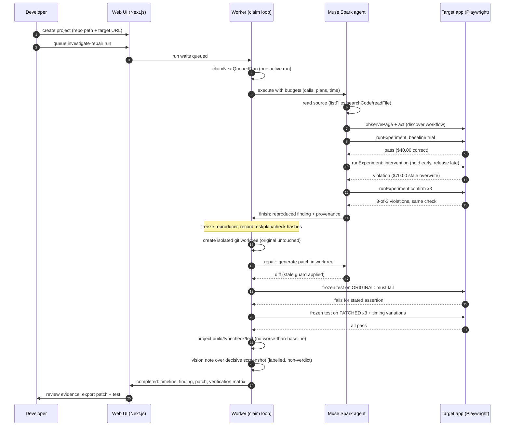

# I'm at the Races

**Built on Meta Muse Spark.** Two $30 transfers should leave $40.
When the slower first response lands last, the balance jumps back to $70 — while
the ledger shows $60 out. Money created from thin air, by nothing more exotic
than responses arriving out of order.

The same bug class silently corrupts checkout totals, inventory counts, live
odds, and search results. Happy-path tests miss it because every response is
individually correct. I'm at the Races is a local developer tool that hunts it
on purpose.

A Muse Spark agent inspects your repository and running app, designs a timing
experiment, holds and releases real browser responses to force the bad order,
and proves the failure with an executable assertion. It then freezes that
reproducer as a regression test, generates a source patch in an isolated git
checkout, and verifies the patch against the frozen test, timing variations,
and your project's own checks. The web UI shows the synchronized timeline,
findings with expectation provenance, the patch diff, and the verification
matrix — every claim backed by persisted evidence with IDs and hashes.

This is not a proof that an app is race-free. It is proof, for the cases it
tests, that a specific failure happens before the patch and does not after.

Set `RACES_MODEL_API_KEY` to your Meta Model API key to enable the agent
(Muse Spark is the default; see `.env.example`). Without a key, runs fail
fast with `MODEL_UNAVAILABLE`.

> **Hackathon judges — fastest path, no API key needed:** the recorded
> fallback bundle replays a complete verified run (timeline, finding,
> patch, verification matrix) with zero setup beyond install. See
> [Demo without a key](#demo-without-a-key) below. Live runs need a Meta
> Model API key. Full pitch: [docs/submission.md](docs/submission.md);
> 3-minute script: [docs/demo.md](docs/demo.md).

## How it works



Timing-critical execution is local code — the model designs experiments,
never the release timing. The repair agent's words never change a verdict;
only executed checks do.

## Measured results

Canonical run on the bank fixture (Muse Spark, investigate-repair):

- Reproduced finding: stale transfer overwrites newer balance, confirmed 3-of-3.
- Verified patch in 1 attempt: stale guard applied unconditionally.
- Frozen reproducer fails on original, passes 3× on patched, plus natural
  workflow, two timing variations, and the project's own suite — all green.
- 18 model calls, 125,746 input / 9,914 output tokens.

Non-fixture proof on [react-movies](https://github.com/adrianhajdin/react-movies)
(1.8k stars, investigated as an instrumented fork — three `data-testid`
hooks, a credential-less null guard, and a `$PORT` start script; no search
logic touched):

- Reproduced finding: stale discover response overwrites newer Inception
  search results, confirmed 3-of-3, with `src/App.jsx` fetch logic cited.

## Demo without a key

```sh
pnpm install
RACES_DIR=/tmp/races-demo node scripts/import-run.cjs /path/to/demo-bundle
RACES_DIR=/tmp/races-demo PORT=3101 pnpm --filter web start
# open http://127.0.0.1:3101/runs/<runId>
```

Every tab replays from persisted evidence: timeline, findings, patch,
verification, and the labelled Muse Spark vision note. No model calls,
no target app, nothing invented.

## Layout

```
apps/web            Next.js App Router UI + JSON API (Node runtime, loopback only)
apps/worker         Worker claim/execute/finish loop (agent executor + model tools)
packages/contracts  Zod schemas + JSON-safe shared types (client-safe)
packages/db         Drizzle + SQLite (better-sqlite3) schema, migrations, query layer
packages/core       Server-side investigation modules (Executor, trial runner, matchers)
tooling/tsconfig    Shared strict TypeScript configs
fixtures/stale-search  Controlled stale-results demo (buggy `/` + guarded `/fixed` control)
fixtures/stale-bank    Canonical bank lost-update demo (buggy `/` + guarded `/fixed` control)
fixtures/stale-odds    WebSocket odds-race demo (buggy `/` + guarded `/fixed` control)
scripts/            Run-bundle export/import for the recorded demo fallback
.races/             Runtime data (SQLite DB + artifacts), gitignored, created on first run
```

Internal dependencies use `workspace:*`. One lockfile (`pnpm-lock.yaml`) is committed;
`packageManager` is pinned to pnpm 10.15.1 and Node 22 is the supported LTS (see `.nvmrc`).

Boundaries: client code cannot import the database, filesystem, model credentials, or browser
execution modules. `packages/db` and `packages/core` import `server-only`; the web app never
imports `packages/core`; all web reads/writes go through `src/lib/server/*` or the API routes.
Next.js never launches Playwright or runs investigations inside a request.

## Setup

Requirements: Node 22, pnpm 10.

```sh
pnpm install     # installs + builds workspace packages (postinstall)
cp .env.example .env  # then add RACES_MODEL_API_KEY (worker-only, never NEXT_PUBLIC_*)
pnpm db:migrate  # create/update .races/races.db (also runs automatically on boot)
pnpm --filter @races/core exec playwright install chromium  # browser for trials
```

Then `pnpm dev` (web on http://127.0.0.1:3000 + worker), create a project pointing at
a repository and its running app, and queue an investigate or investigate-repair run.

## Development

```sh
pnpm dev         # web (http://127.0.0.1:3000) + worker skeleton together; Ctrl-C stops both
pnpm dev:web     # Next.js only, bound to loopback
pnpm dev:worker  # worker skeleton only
pnpm db:migrate  # apply pending SQLite migrations to .races/races.db
pnpm typecheck   # strict tsc across all packages
pnpm test        # vitest suites (isolated temp databases; excludes the fixture targets)
pnpm test:fixture # fixture suites: 1 test each fails by design until the race is repaired
pnpm build       # packages + production Next.js build + worker build
```

Then open [http://127.0.0.1:3000/projects](http://127.0.0.1:3000/projects) in a browser
(`/` redirects there).

## Environment

All variables are optional; see `.env.example`. Defaults work out of the box.

| Variable | Default | Read by |
|---|---|---|
| `RACES_DIR` | `<repo>/.races` (resolved from the workspace root regardless of cwd) | `apps/web`, `apps/worker` |
| `PORT` | `3000` | `apps/web` (Next.js convention) |
| `RACES_MODEL_API_KEY` | unset → runs fail `MODEL_UNAVAILABLE` | `apps/worker` only (loaded from `.env`, never committed) |
| `RACES_MODEL` | `muse-spark-1.3-contributor` | `apps/worker` only |
| `RACES_MODEL_PROVIDER` | `openai-responses` (Meta Muse Spark; `anthropic` is an optional fallback) | `apps/worker` only |
| `RACES_MODEL_BASE_URL` | `https://api.meta.ai/v1` for Meta | `apps/worker` only |
| `RACES_ARTIFACT_CAP_MB` | `250` per run | `apps/worker` (evidence budget; excess captures are skipped and labeled) |

Never expose a model key through a `NEXT_PUBLIC_*` variable — that prefix bundles the value
into client JavaScript.

Model boundary (please read before pointing this at a real project): source excerpts,
browser observations, and recorded traffic excerpts are sent to the configured model
provider. This tool is local-first, not offline. Recorded URLs and excerpts pass through
obvious-pattern redaction (known secret query keys, bearer/basic credentials), but page
text and screenshots are kept verbatim — use synthetic demo data for anything sensitive.

## Persistence

SQLite lives at `.races/races.db` (WAL mode, busy timeout, foreign keys on) so the web and
worker processes share it safely. Tables: `projects`, `runs`, `run_events` (unique sequence
per run), `artifacts` (with size/hash), `experiments`, `trials`, `findings`, `reproducers`,
`repair_attempts`, `verification_checks`. Migrations are versioned in
`packages/db/src/migrations.ts` and apply transactionally; run state changes that append
events use transactions as well. Artifact bytes live under `.races/artifacts/<runId>/`.

Run status (`queued → running → completed|failed|cancelled|interrupted`) is separate from the
investigation phase (`queued`, then worker-owned phases). Event polling is cursor-based:
`GET /api/runs/[runId]/events?after=<sequence>`; the response shape is kept suitable for a
later SSE stream.

## Current limitations

- Every agent run costs model latency and tokens (a full investigate-repair run
  is typically 10–30 calls over 2–8 minutes). Point targets at the fixture or
  another synthetic app. Run one worker per database.
- No authentication, no multi-user support — this is a single-operator local tool
  bound to loopback. Mutation routes reject cross-origin browser requests.
- Repair needs a git checkout: dirty tracked files under the target subpath refuse
  isolation, and the target package needs `build`/`start` scripts plus a
  regression suite that asserts correct behavior (a suite pinning the bug can
  never verify — see `fixtures/stale-search/README.md`).
- The isolated checkout is not an OS security sandbox: local commands run with
  the developer's machine permissions. Trusted local projects only.
- Assertion operators are `textContains`/`textEquals`; repairs are capped at 2
  attempts; evidence is capped at 250 MiB per run (excess captures are skipped
  and labeled, never silently dropped).
- History is append-only: reruns create new linked runs; nothing is mutated.

## Cleanup

Evidence is preserved until explicitly removed. To wipe local state, stop the
web/worker processes and delete the runtime directory (default `.races/`, or
`$RACES_DIR`); repair workspaces live under `<racesDir>/workspaces/` and go with
it. If a worktree outlives a crash, `git worktree prune` it from the target repo.

## Demo and submission

- `docs/demo.md`: the 3-minute demo script, the recorded fallback bundle
  (export/import scripts that preserve run IDs and source identity), measured
  OP02 timings, and rehearsal notes.
- `docs/submission-checklist.md`: release checklist, including the organiser
  items that must be verified from the event portal (deadline, timezone,
  eligibility, video upload).
- `docs/submission.md`: paste-ready portal copy (pitch, Meta tooling,
  disclosures, links).
- `docs/sequence-diagram.md`: the architecture sequence in standalone form.
