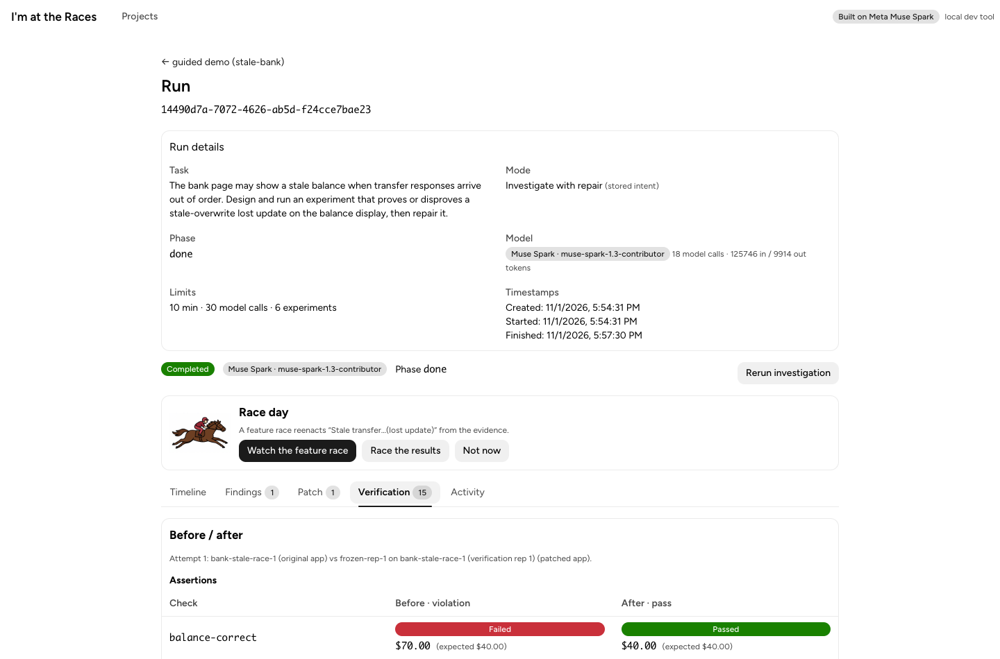
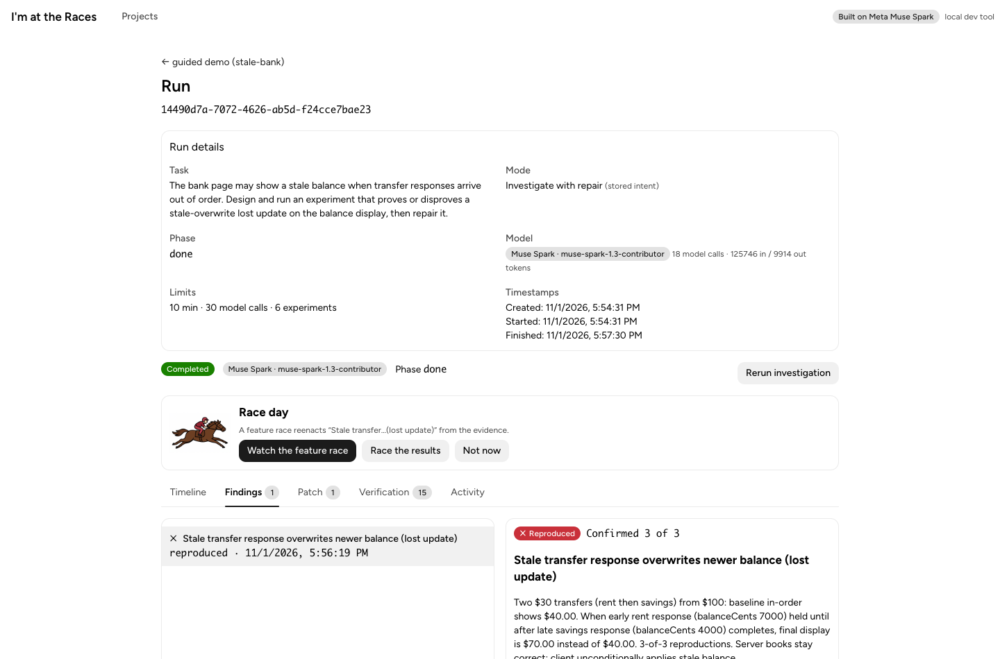
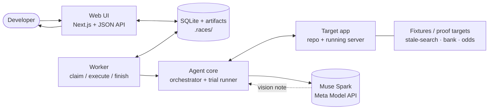
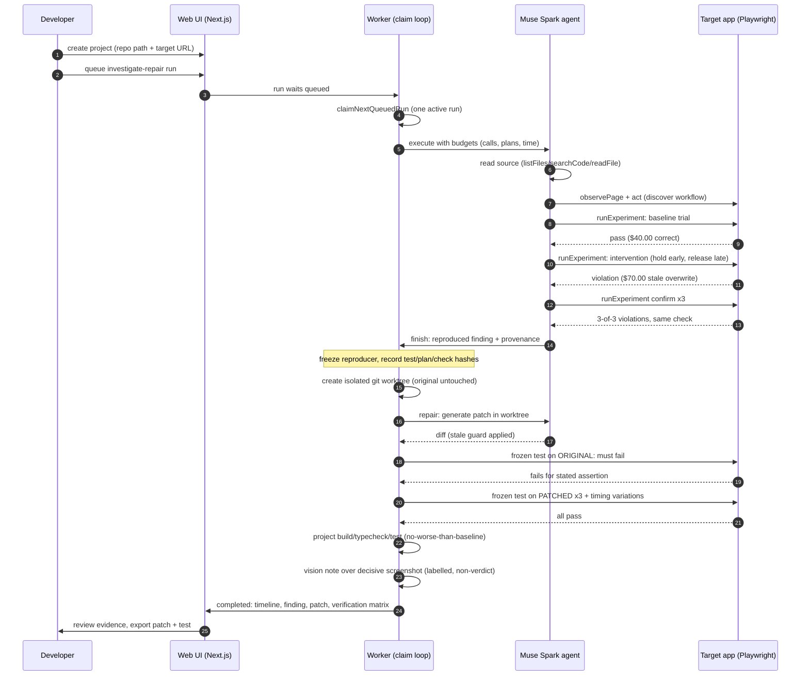

# I'm at the Races

Built on Meta Muse Spark.

Two $30 transfers from a $100 balance should leave $40. If the first
response is slow and lands after the second, the balance jumps back to
$70, while the ledger still shows $60 paid out. Nothing was hacked. Two
correct responses just arrived in the wrong order.

The same fault hides in checkout totals, inventory counts, live prices,
and search results. Normal tests miss it because each response is correct
on its own. This is a local developer tool that goes looking for it.

## What it does

A Muse Spark agent reads your repository and the running app, works out
an experiment, and runs it in a real browser. Responses are held back and
released late so the slow one lands last. If the screen ends up wrong, an
executable assertion says so, and that failure is frozen as a regression
test.

The tool then writes a patch in an isolated git checkout (your own
checkout is never touched) and checks it: frozen test on the original
(must fail) and on the patch (must pass 3 times), timing variations, and
your project's own suite. Timing and verdicts run in local code. The
model designs experiments, but its words never change a verdict.

A green run means only this: for the cases tested, the failure happened
before the patch and did not happen after.

> Hackathon judges: no API key needed. The recorded bundle in
> `demo-bundle/` replays a complete verified run. See
> [Demo without a key](#demo-without-a-key). Pitch:
> [docs/submission.md](docs/submission.md). Demo script:
> [docs/demo.md](docs/demo.md).





Initial plan


## System overview



## How it works



## Results so far

On the bank fixture (investigate-repair, Muse Spark): the stale transfer
overwrote the newer balance 3 times out of 3, one patch attempt fixed it,
and the frozen reproducer then passed on the patched app, a natural
workflow, two timing variations, and the project suite. 18 model calls,
125,746 input and 9,914 output tokens.

Fixtures I built only prove so much, so I also ran it against
[react-movies](https://github.com/adrianhajdin/react-movies) (1.8k stars,
instrumented fork, search logic untouched). A stale discover response
overwrote the newer Inception results, 3 times out of 3, citing the fetch
logic in `src/App.jsx`.

## Demo without a key

```sh
pnpm install
RACES_DIR=/tmp/races-demo node scripts/import-run.cjs demo-bundle
RACES_DIR=/tmp/races-demo PORT=3101 pnpm --filter web start
# open http://127.0.0.1:3101/runs/14490d7a-7072-4626-ab5d-f24cce7bae23
```

Every tab replays from evidence saved during the original run, including
the Muse Spark vision note, labelled as a model explanation. Importing
makes no model calls.

## Run it live

You need Node 22 and pnpm 10.

```sh
pnpm install
cp .env.example .env   # add RACES_MODEL_API_KEY (worker only)
pnpm --filter @races/core exec playwright install chromium
pnpm dev               # web on http://127.0.0.1:3000 plus worker
```

Muse Spark (`muse-spark-1.3-contributor`, Meta Model API) is the
default. Without a key, runs fail fast with `MODEL_UNAVAILABLE`. Never
put the key in a `NEXT_PUBLIC_*` variable.

Useful commands: `pnpm typecheck`, `pnpm test`, `pnpm build`, and
`pnpm test:fixture` (each fixture suite has one labelled test that is
meant to fail on the buggy code).

Data lives in `.races/` (SQLite plus artifact files). Delete that
directory to start over. Full environment table: [.env.example](.env.example).

## Layout

```
apps/web        Next.js UI and JSON API (loopback only)
apps/worker     Claims runs and executes investigations
packages/core   Agent, browser trials, repair and verification
packages/db     SQLite schema and queries
packages/contracts  Shared Zod types
fixtures/       stale-search, stale-bank, stale-odds (buggy + /fixed control)
```

## Limits worth knowing

- A full run takes 2 to 8 minutes and 10 to 30 model calls. Use
  synthetic targets, and one worker per database.
- Local-first does not mean offline. Source excerpts, page text, and
  screenshots go to the model provider and are stored verbatim. Use
  synthetic data for anything sensitive.
- Single operator, no auth, loopback only. The repair checkout is
  isolation, not a security sandbox: it runs with your permissions.
- Repair needs a clean git checkout with `build`/`start` scripts and a
  test suite that asserts correct behaviour. Two attempts at most.
