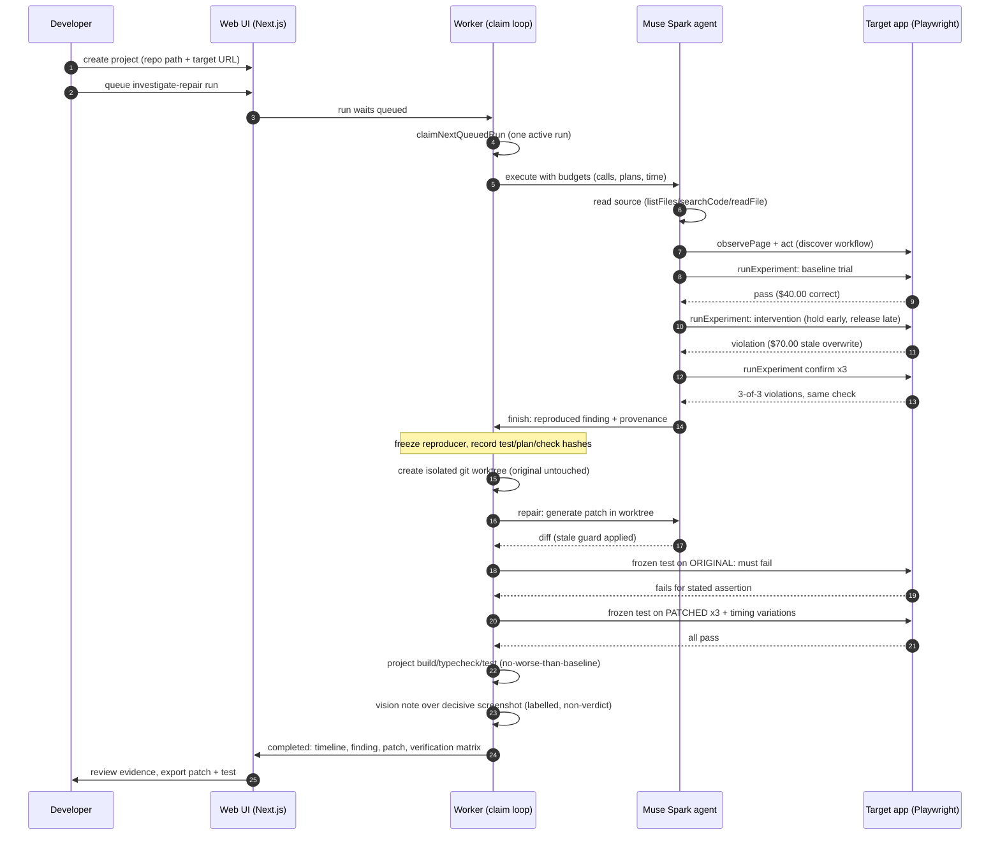

# Sequence diagram: investigate, repair, verify

Render with any Mermaid renderer (VS Code Mermaid preview,
[mermaid.live](https://mermaid.live), or `npx @mermaid-js/mermaid-cli`).
Screenshot the render for the video or submission docs.

